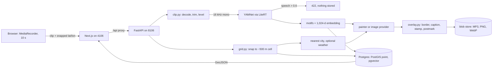

# Architecture

One page. The README has the stories; this is the map.

## The pieces

**Audio** (`api/app/audio`). PyAV decodes whatever the browser recorded (Opus in WebM, AAC in MP4) with its bundled FFmpeg. The clip is trimmed to 10 s, levelled to -23 dBFS and split into two renditions: 16 kHz for the model, a 32 kHz 64 kbit/s MP3 for people. YAMNet returns 20 frames of 521 class scores and 20 embeddings. Speech probability is the mean over frames of the strongest speech class. The embedding is the frame mean, unit length. `motifs.py` folds 353 of the classes into 20 motifs, which are both the tags people see and the painter's instructions.

**Privacy grid** (`api/app/geo/grid.py`, mirrored in `web/src/lib/grid.ts`). Latitude snaps to 5 millidegrees. The longitude step doubles in bands (5, 10, 20 ... 320) so a cell stays between 393 m and 786 m wide at any latitude. The browser snaps before sending, the server snaps again, and the table stores only `lat_md` and `lon_md` as integers under CHECK constraints. The PostGIS point is a generated column.

**Postcard** (`api/app/postcard`). `PostcardBrief` carries the top three motifs, time of day, place and weather, and builds the text prompt. `ImageProvider` turns a brief into art: the default is `scene.py`, a seeded procedural painter (six settings, twenty motifs, four palettes) on a small gouache engine in `paint.py`; the OpenAI-compatible provider is env-driven and falls back to the painter on any error. `overlay.py` then adds everything with letters in it.

**Queries** (`api/app/service.py`). Map: a bounding box on the GiST index, returned as GeoJSON built inside Postgres; above `MAX_PINS` rows the database groups on `ST_SnapToGrid` sized to the zoom. Feed: `ST_DWithin` on geography. Similar: `ORDER BY embedding <=> $1` on an HNSW index, with an optional `ST_DWithin` filter and iterative scan so filtered searches still fill.

**Web** (`web/src`). Next.js App Router. The map is MapLibre GL with client-side clustering; cluster counts are canvas images so no font server is needed. `mapStyle.ts` chooses between OpenFreeMap (recoloured) and a bundled Natural Earth basemap. A hand-written service worker caches the shell and immutable media.

## Interfaces with an offline default

| Interface | Default | Alternative |
|---|---|---|
| `BlobStore` | directory on disk | S3-compatible (untested) |
| `ImageProvider` | built-in painter | OpenAI-compatible images API (untested live) |
| `PlaceNamer` | nearest city in a bundled GeoNames table | Nominatim |
| `WeatherSource` | none | Open-Meteo |
| basemap | OpenFreeMap, else bundled outlines | any MapLibre style URL |
| `AudioTagger` | YAMNet (local file) | anything with `tag(samples)` |

## Invariants

- A raw coordinate is never written, logged in a query string, or sent to a third party. Only grid points are.
- A refused clip leaves nothing behind: no row, no file, no quota spent.
- Equal briefs paint byte-equal postcards. Bundled fonts, seeded generator, no system state.
- A file in `assets/generated` overrides the same path in `assets/interim`, one file at a time.

## Moderation

Ten accepted uploads per device per rolling 24 hours, counted in `upload_events` under an advisory lock so two tabs cannot both take the last slot. Three reports from different devices hide a postcard. `DELETE /api/admin/postcards/{id}` and two review endpoints need `ADMIN_TOKEN`; with no token set they answer 503.

## Decisions I would revisit

- The device id is a random value in localStorage. It stops accidents, not abuse. A real deployment needs an IP or proof-of-work limit behind it.
- Speech is all or nothing per clip. Muting the frames that contain speech would keep more recordings and protect bystanders just as well.
- YAMNet embeddings group sounds by class. CLAP would allow searching by description, at the cost of a much larger model.
