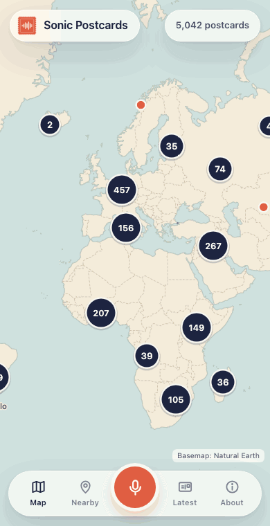
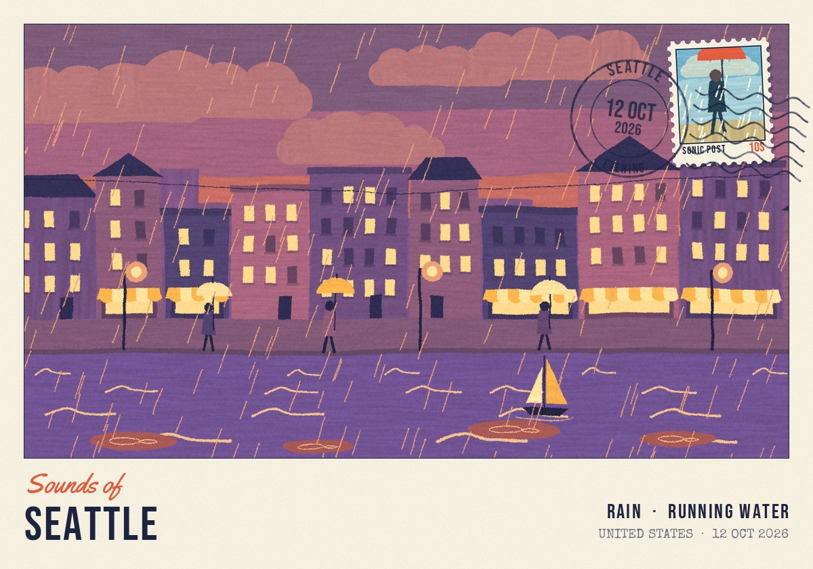
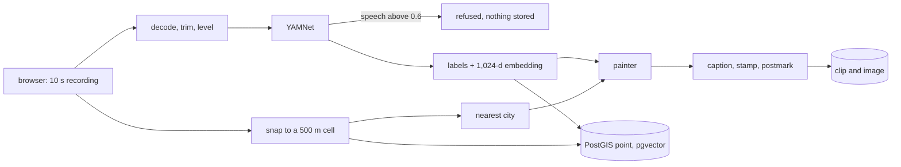
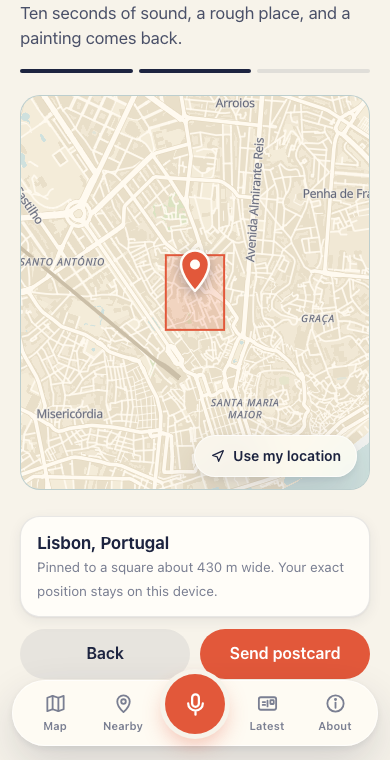

<div align="center">

# Sonic Postcards

### ten seconds of how a place sounds, mailed to a shared map

[](api)
[](web)
[](db)
[](api/tests)
[](LICENSE)

<br>



</div>

<br>

Stand somewhere and hold your phone still for ten seconds. Rain on an awning will do, or the particular hum of your own street at dusk. Sonic Postcards listens to the clip, decides what it is hearing, paints a small gouache scene to match, and pins the result to a world map where anyone can tap it and listen.

Two rules shape most of the engineering. The first is that it does not want your voice or anyone else's, so a clip that is mostly speech is refused before anything is stored. The second is that it does not want to know where you live. Your pin lands on a square roughly 500 metres across, and the database is physically unable to hold anything more precise.

<p align="center"></p>
<p align="center"><sub>What came back when I uploaded a rain clip with Seattle coordinates during my own check of a fresh clone. The lettering, stamp and postmark are set by code from stored facts, so they are never misspelled.</sub></p>

<br>

## Table of contents

- [Run it](#run-it)
- [What happens to a clip](#what-happens-to-a-clip)
- [The 500 metre promise](#the-500-metre-promise)
- [No voices](#no-voices)
- [Sounds like this](#sounds-like-this)
- [The postcard](#the-postcard)
- [The parts that fought back](#the-parts-that-fought-back)
- [Acceptance tests](#acceptance-tests)
- [Limitations](#limitations)
- [Next](#next)
- [Layout and credits](#layout-and-credits)

<br>

## Run it

```bash
git clone https://github.com/ayaan-gupta/sonic-postcards && cd sonic-postcards && make dev
```

Open http://localhost:4106. You need Docker, Python 3.12, Node 22 and `make`. Nothing else has to be installed, because FFmpeg rides inside the PyAV wheel and the audio model is a 16 MB file in this repo.

The command builds a Postgres image with PostGIS and pgvector, installs both halves of the app, runs the migration, and seeds 42 demo postcards so the map is not empty. It was healthy 37 seconds after a fresh clone on my machine with warm package caches.

There is no `docker compose` file, and that is deliberate. The machine this was built on has no compose plugin, and I would sooner ship a Makefile I ran than a compose file I could not.

The web app is on 4106, the API on 8106 and Postgres on 5506. `make help` lists every other target, and [.env.example](.env.example) documents the settings.

<br>

## What happens to a clip



1. **Record.** MediaRecorder captures ten seconds, with the browser's voice processing switched off. Echo cancellation and noise suppression exist to erase exactly the thing this app is for.
2. **Clean up.** PyAV decodes whatever container the browser produced, and the clip is trimmed and levelled to 10 seconds of 16 kHz mono.
3. **Listen.** YAMNet scores 521 kinds of sound. Those collapse into 20 motifs such as rain, traffic, birds and bells, and the layer just before the classifier becomes the clip's embedding.
4. **Refuse or keep.** Above 0.6 speech probability the clip is rejected with an explanation.
5. **Place.** Coordinates are snapped to the privacy grid, and the nearest city comes from a bundled table of 34,160 places.
6. **Paint and post.** The scene is painted, the template adds its lettering, and the card goes on the map.

The round trip for the Seattle card above took 1.45 seconds.

<br>

## The 500 metre promise

<p align="center"></p>

The PRD's acceptance test says stored coordinates must never carry more precision than the rounding rule, verified in the database. I took "in the database" literally.

Coordinates are stored as integer millidegrees. A CHECK constraint requires each one to sit on the grid, and the PostGIS point is a generated column computed from those integers, so there is no float column to leak into. A direct `INSERT` with an off-grid value fails. The test sends uploads with seven decimal places and then asks Postgres itself to find a row that is off the grid. It finds none, and the digits that were sent appear nowhere.

When I uploaded `47.6062431, -122.3320712`, the row that came back read `47605 | -122330`.

The grid has one subtlety, and it is in [the war stories](#the-parts-that-fought-back): a square that is 500 metres wide in Lagos is half that in Oslo unless you do something about it.

<br>

## No voices

A bystander on a street recording did not agree to be on a public map. The speech check is the app's way of respecting that, and the PRD makes it an acceptance test.

| Clip | Speech probability | Result |
|---|---|---|
| A monologue, Opus in WebM | 0.998 | refused |
| A two-voice chat, AAC in MP4 | 0.999 | refused |
| Speech over rain | 0.817 | refused |
| Rain with one "hello there" | 0.021 | accepted |

A refusal says what happened and what to do next: *"This clip sounds like mostly speech, so it was not posted. Sonic Postcards only keeps ambient sound, to protect the people around you."*

The caveat is a big one. Those voices are the macOS `say` command. No human recording has been through this check, and neither has a second language.

<br>

## Sounds like this

Every postcard has a button that finds the clips most like it anywhere in the world, by cosine distance over the embeddings in pgvector, with an optional radius.

The fixture set in the repo is synthetic, which makes the acceptance test easy: all six rain queries return five rain clips out of five. That proves the plumbing. For a result that means something I pulled 96 real clips from ESC-50, eight in each of twelve classes, and ran the same search.

| | Real clips |
|---|---|
| Rain queries with rain in the top 5 | 8 of 8 |
| Average rain clips in a rain query's top 5 | 4.5 |
| Worst rain query | 1 of 5 |
| All classes, results sharing the query's class | 3.62 of 5, where chance is 0.37 |
| Weakest classes | wind 1.62, engine 2.0, crickets 2.38 |

ESC-50 is licensed CC BY-NC, so those clips are fetched by `make fetch-real` and never committed. `make eval` reproduces the table.

<br>

## The postcard

The PRD's style bible asks for a vintage travel postcard in gouache with a stamp and a postmark, and it insists that the text be rendered by a template so that it is always correct. That last part is the wisest sentence in the brief. No image model is ever asked to spell here.

By default no image model is asked to do anything. The scene comes from a rule-based painter with six settings and twenty motifs, tinted by one of four time-of-day palettes. An adapter for a hosted image API sits behind the same interface and has only ever been run against a mock.

Thirty design-time images (twenty stamps, the postmark, logo, icons, onboarding pictures) are requested in [assets/prompts.md](assets/prompts.md), since the brief does not allow me to generate them. The stand-ins in `assets/interim` are painted with the same gouache engine as the postcards, and a file saved to `assets/generated` replaces its twin.

<br>

## The parts that fought back

**A "500 m" grid is not 500 m in Oslo.** Version one rounded both coordinates to 0.005 degrees. That is 556 metres of latitude everywhere, but only 278 metres of longitude at 60 degrees north, so the privacy cell shrank by half precisely where it should not. The longitude step now doubles in bands as you move toward the poles, which keeps every cell between 393 and 786 metres wide. The band list stops at 320 millidegrees because the next doubling does not divide 360,000, and the grid has to close cleanly at the antimeridian. The rule is written once in Python and again in TypeScript, with a Postgres function as the final word. One shared file of 253 test vectors keeps them in agreement.

**Synthesising sounds for a model that has only heard real ones.** With no dataset on the machine, the demo clips had to be built from noise and sine waves and then tagged by the real YAMNet. My first "wind" came back as Vehicle, so it is now the traffic fixture. My second came back as Ocean at 0.90 and became the waves fixture. Wind finally worked as noise below 250 Hz with a 20 Hz flutter, which tells you something: what the model knows as wind is a microphone being buffeted. A train never worked at all. Four attempts at bells still read as Music.

**Map text without a font server.** MapLibre sets text from glyph files fetched over HTTP, which breaks the rule that the app should work with no network. Cluster counts and city labels are drawn on a canvas in the system font and handed to the map as images. A side effect turned up in the 5,000 pin screenshot, where two bubbles looked corrupted. The cause was geometric. Cluster centres drift as points merge, and two clusters had landed almost on top of each other. Collision detection sorted by count fixed it.

**A globe's coastlines on a flat map.** The bundled basemap uses Natural Earth outlines prepared for spherical projection. Eurasia's ring steps from longitude 179.9 to -179.9 at Chukotka, and Antarctica's ring never returns to its start, so MapLibre drew cream streaks across the Atlantic. A small module now unwraps the jumps and closes the polar rings.

**A WAV file as the microphone.** Chromium can feed a file into `getUserMedia`, which lets `make e2e` run the real recorder and the real model in a headless browser. It found two bugs no unit test would have. The progress ring's SVG sat on top of the record button and swallowed every tap. And a GPS fix that arrived before the map had loaded was silently dropped.

Smaller ones: Next.js rewrites are frozen at build time, so the API proxy had to become middleware. My own rolling-window test for the rate limit was wrong and the code was right. An early painter gave every ground slot to the main motif, which is how a postcard tagged "market, music, bells" ended up with no guitar in it. And pgvector hands back its own vector type, which numpy declines to convert.

<br>

## Acceptance tests

| PRD test | Result | Measured |
|---|---|---|
| A clip of mostly speech is rejected with a clear message | Met | Three speech clips scored 0.82 to 0.999 and were refused with HTTP 422. Also checked in a browser with speech played into the microphone. |
| Stored coordinates never contain more precision than the rounding rule, verified in the database | Met | Zero rows off the grid after 7-decimal uploads. Six kinds of direct off-grid `INSERT` fail on a CHECK constraint. |
| "Sounds like this" on a rain clip returns rain clips in its top 5 | Met on the synthetic fixtures and on real clips | 6 of 6 synthetic queries return 5 of 5. On real ESC-50 audio, 8 of 8 queries have rain in the top 5. |
| Map loads 5,000 pins in under 2 seconds using clustering | Met | 5,042 pins. The API answers in a median of 36 ms. Cold browser load of the production build: median 1,083 ms on the bundled basemap, 1,559 ms on the online one. |

Two of those rows are closer calls than they look. The worst cold load with the online basemap was 1,935 ms, which is 65 ms inside the limit and depends on someone else's tile server having a good day. And the timings come from headless Chromium with software rendering on a fast laptop, which is a strange proxy for a phone in both directions.

Behind the table sit 70 Python tests against a real Postgres and the real model, plus 17 TypeScript tests. Seven more checks drive a browser.

<br>

## Limitations

- **The demo postcards are synthetic sound.** They are marked "Sample" in the app, and their tags are whatever YAMNet makes of my noise generators. The committed rain fixture is tagged "Running water" first and "Rain" second.
- **The speech check is one number per clip.** Five seconds of clear speech in ten scores about 0.5 and gets through. It has never met a human voice.
- **No real phone was used.** Safari's MP4 path is tested with an AAC file that PyAV encoded. Browsers also demand HTTPS for the microphone anywhere other than localhost, and no HTTPS setup is included.
- **The rate limit is polite fiction against anyone determined.** Ten postcards per device per day, keyed on an id in localStorage. Clearing storage resets it.
- **Moderation has endpoints and no screen.** Reports auto-hide a card at three, and an admin token can delete or restore.
- **The built-in painter has a small imagination.** Two postcards with the same motifs and time of day look like siblings.
- **The hosted image provider and the S3 store have only met mocks.**
- **The offline basemap has coasts and cities but no streets,** so picking your square without a network is guesswork.
- **Similarity search at scale is unmeasured.** It relies on pgvector's iterative HNSW scan for the filtered case.

<br>

## Next

1. Search by description, such as "rain on a tin roof", with CLAP embeddings stored beside the YAMNet ones.
2. Mute only the frames that contain speech. A street recording with one passer-by deserves to survive.
3. A page per grid cell: how the same square sounds at dawn and at midnight, in July and in January.

<br>

## Layout and credits

```
api/app/audio/       decode, trim, level, YAMNet tagging, the 20 motifs
api/app/geo/         the privacy grid and nearest-city lookup
api/app/postcard/    the painter and the lettering overlay
api/app/migrations/  one SQL file with the CHECK constraints and the generated point
api/tests/           70 tests, grouped by milestone
web/                 Next.js PWA: MapLibre map, recorder, postcard pages, nearby feed
db/                  the Postgres image with PostGIS and pgvector
scripts/             ESC-50 fetch and evaluation
assets/              prompts.md (image requests), interim/ (code-painted stand-ins)
```

[ARCHITECTURE.md](ARCHITECTURE.md) has the data model and the invariants on one page.

Sound tagging is Google's [YAMNet](https://github.com/tensorflow/models/tree/master/research/audioset/yamnet) (Apache 2.0). Place names come from [GeoNames](https://www.geonames.org) (CC BY 4.0) and the offline outlines from [Natural Earth](https://www.naturalearthdata.com). The online basemap is [OpenFreeMap](https://openfreemap.org), built on data from OpenStreetMap contributors. The evaluation clips are from Karol Piczak's [ESC-50](https://github.com/karolpiczak/ESC-50). Postcard fonts are Bebas Neue, Special Elite and Yellowtail, each under its own open licence in `api/app/fonts`.

## License

MIT. See [LICENSE](LICENSE).
